# Autonomous Debris-Transport Robot (PMR)

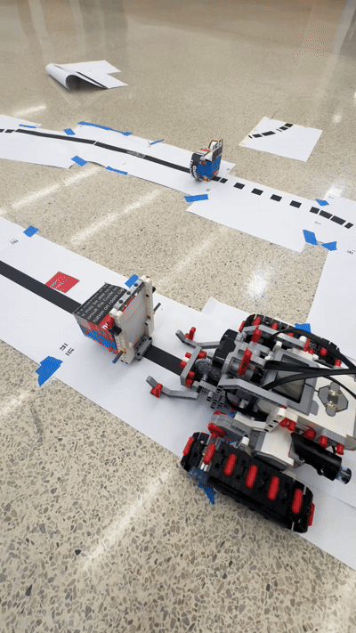

A scaled prototype robot that autonomously moves debris bins inside a mobile Thermal Depolymerization (TDP) plant. Built with LEGO EV3 and programmed in LabVIEW.

## Problem
Natural disasters leave large amounts of organic and non-organic debris. Sending it to landfills is unsustainable and harms the environment. A mobile TDP plant can turn this debris into renewable energy, but it needs an efficient, autonomous way to move shredded debris from the separator/shredder to each processing station.

## Goal
Build a scaled prototype robot (PMR) that:
- Follows predefined black lines around a closed-loop track
- Picks up a bin at the separator/shredder station
- Identifies the bin's weight and material
- Delivers it to the correct processing station and returns

## Project Diagram
### Functional diagram
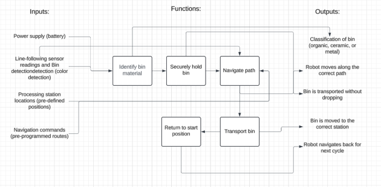

### Gantt Chart
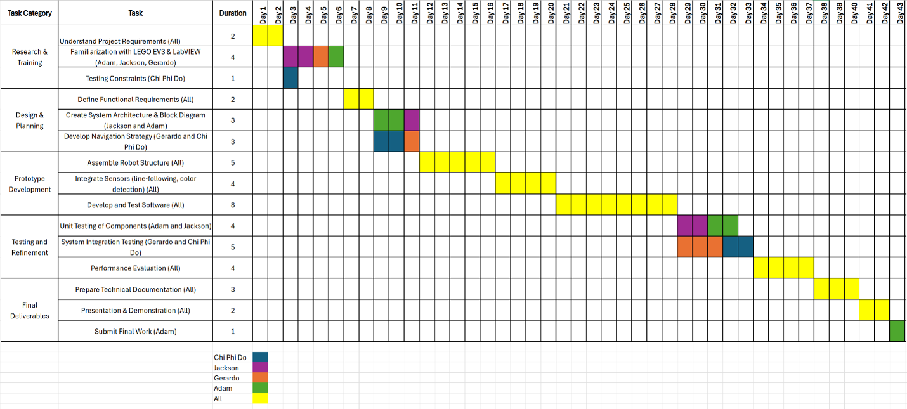

## Hardware and Software
- LEGO EV3 brick and sensors
- Tank tracks for uneven terrain
- LabVIEW
- Size limit: 40 cm x 40 cm x 50 cm

### Hardware system
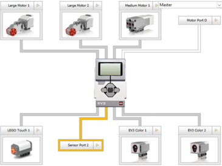
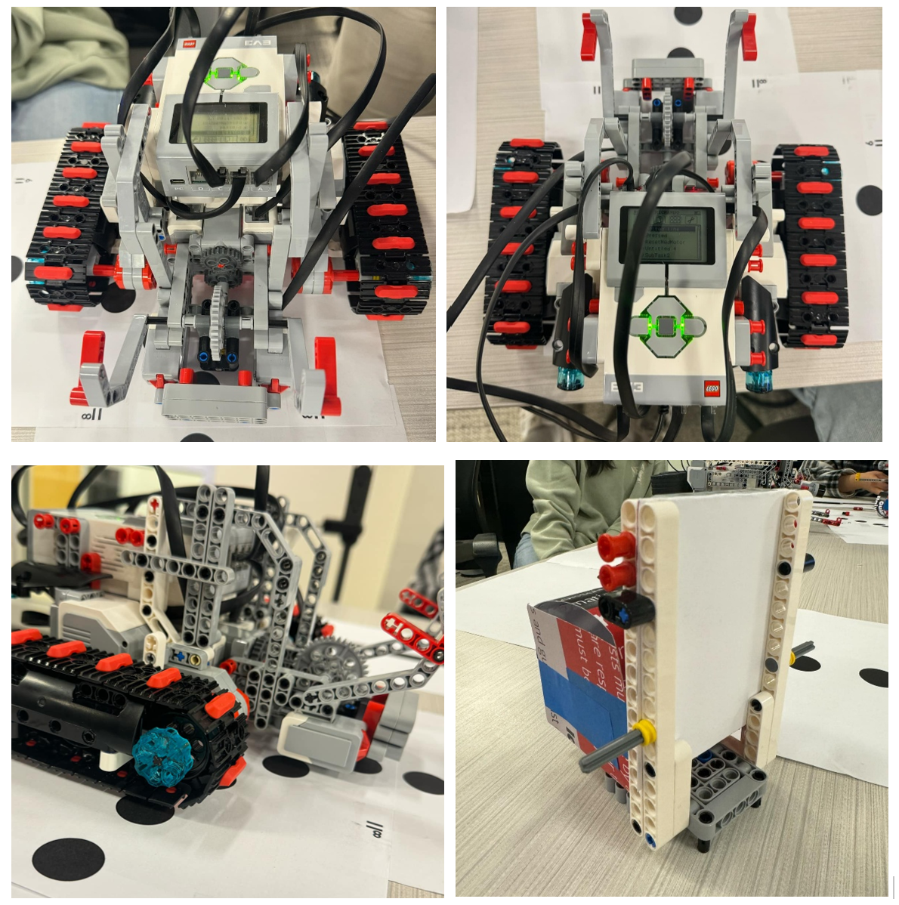

### LabVIEW Program
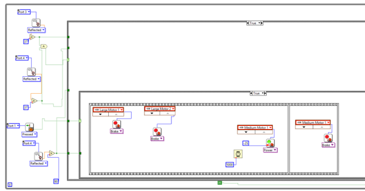
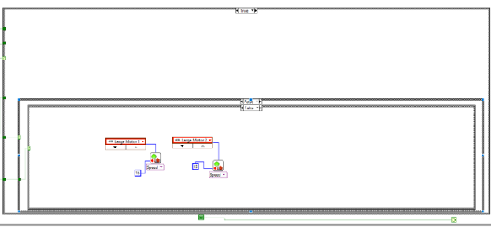
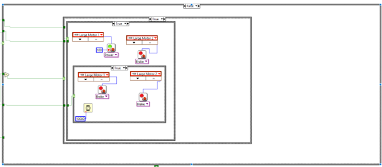
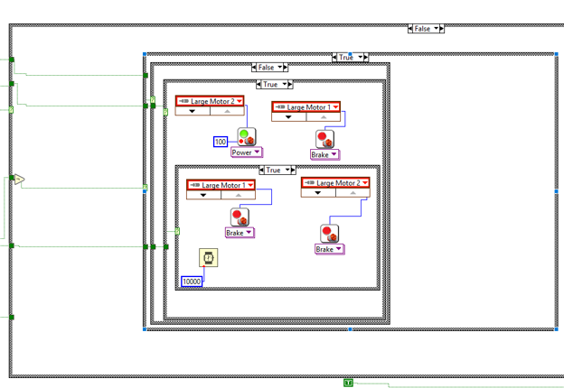
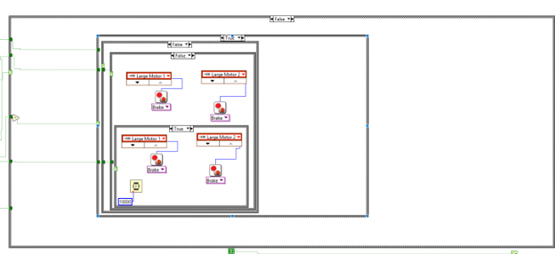
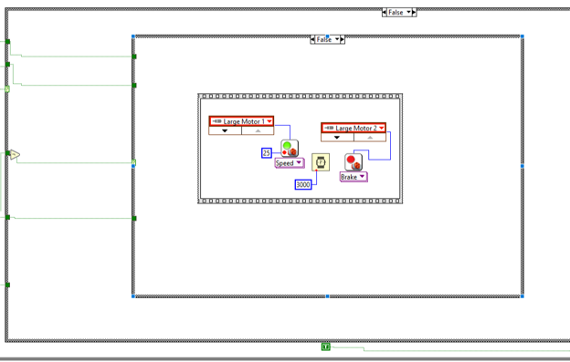

## Results

| # | Requirement | Result | Notes |
|---|---|---|---|
| 1 | Navigation and path following | Achieved | Completed Zones 1–7, subtask stations, and the full track |
| 2 | Bin identification | Achieved | Identified weight and material (organic, ceramic, metal), met the 80% accuracy target |
| 3 | Fully autonomous run | Not achieved | Dotted-line sensing sometimes misread, sending the robot off track |
| 4 | Durability on uneven terrain | Not tested | Sturdy build with tank tracks; not tested in the final demo |
| 5 | Return to separator/shredder | Partial | Completed one full drop-off and return; could not enter Zone 1 of the final track because it was not programmed to |
| 6 | Ease of maintenance | Not tested | EV3 parts and LabVIEW code are easy to repair and modify |
| 7 | Storage and deployment | Not tested | Designed within the 40 x 40 x 50 cm limit |
| 8 | Load capacity | Achieved | Picked up, carried, and dropped bins of 25, 75, and 125 g (±20 g) with no loss of stability |

## Takeaways
- **Iterative design and testing:** small changes in code or hardware had a big effect on performance, so every test run guided the next fix.
- **Sensor calibration:** light sensor calibration strongly affected line following, especially on dotted and curved paths.
- **Programming for autonomy:** we wrote modular, fault-tolerant code so the robot could run a full task sequence without help.
- **Teamwork:** integrating mechanical design, sensors, and programming required clear task splits and constant communication.
- **Engineering mindset:** we worked through real constraints like uneven terrain, changing loads, and sensor-based decisions.

## My Role: Team Leader
- Gathered and weighed each member's ideas, then used a decision matrix and precedence network to make final design and schedule decisions
- Matched tasks to each member's strengths to save time and improve productivity

## Team
- Ethan Do: Project Leader
- Jackson Kain: Design Engineer
- Gerardo Ramos-Tapia: Documentation & Quality engineer
- Adam Bentley: Analysis Engineer

